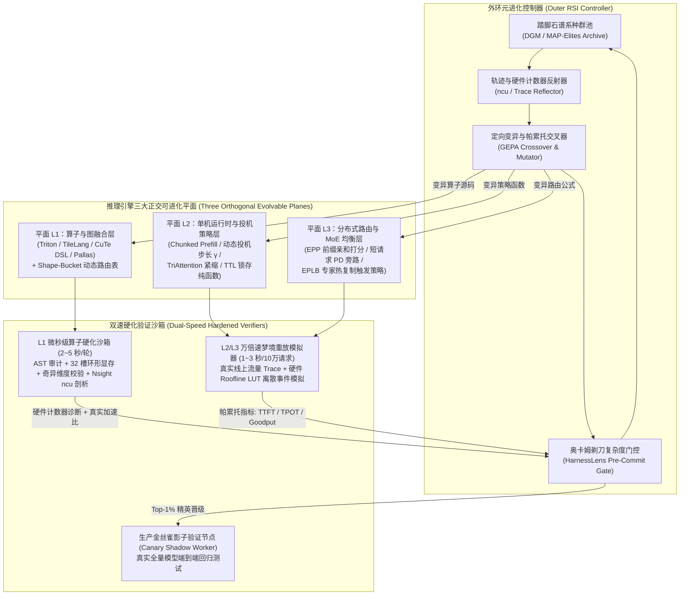

# 面向大模型推理引擎的递归自我改进系统（Auto-Inference-RSI）架构设计与工程落地蓝图

> **文档定位**：本文档提供一套**100% 聚焦于大模型推理引擎（如 vLLM / SGLang / Xinference / TensorRT-LLM）** 的递归自我改进（Recursive Self-Improvement, RSI）系统设计方案与工程实施指南。
> 通过将推理引擎解耦为 **“三大正交可进化平面”**，配以 **“秒级硬化微基准沙箱 + 万倍速轨迹重放梦境模拟器”**，并利用 **自指加速飞轮（用进化后的引擎加速进化 Agent 自身）**，实现从底层 GPU/TPU 算子、单机 KV/投机调度器到分布式路由策略的全自动、防作弊、可持续自进化。

---

## 一、 为什么“推理引擎”是构建工程级 RSI 的最佳靶点？

在通用软件工程中构建 RSI 极易撞上“评估主观、反馈极慢、奖励作弊（Reward Hacking）”三座大山。但如果将范围**严格收敛到推理引擎本身**，你会发现它拥有全 AI 领域最完美的物理闭环特性：

### 1. 绝对客观、连续可微的物理验证信号
- **正确性（Correctness）有严格数学定义**：算子层要求输出张量相对于 FP32 参考实现的余弦相似度 $>0.9995$ 且最大绝对误差在半精度容差内；投机采样与调度层在数学上必须严格保证输出 Token 分布与基线无损一致。
- **性能（Performance）有纳秒级硬件度量**：没有主观打分，直接由 GPU 硬件计时器（CUDA Events）、硬件性能计数器（`Nsight Compute` SM 利用率 / HBM 带宽利用率 / 寄存器溢出量）以及端到端 SLO 指标（**TTFT、TPOT、单卡有效吞吐 Goodput**）给出客观裁决。

### 2. 独一无二的“自指加速飞轮（Self-Referential Ignition）”
这是推理引擎专属 RSI 最核心的物理杠杆：**负责生成和改进算子/调度器代码的外环 Coding Agent，本身就运行在被它优化的这套推理引擎之上！**

观察 RSI 自身的推理工作负载特征，你会发现两个惊人的事实：
1. **95% 以上的输入前缀完全相同**：同一批次的数百次进化迭代共享完全相同的系统 Prompt、目标硬件规范、基线代码上下文与历史种群记录；
2. **85% 以上的输出代码与输入代码重合**：当外环 Agent 修改一个 150 行的 Triton 算子或 60 行的调度策略函数时，新生成的变体代码中有 85% 的代码行、变量名和缩进结构直接来自输入 Prompt 中的父代代码！

这意味着什么？
```text
[第 0 代引擎: 80 tok/s]
       │
       ├──> 进化出 L1 融合算子 + L2 (Prefix Caching + DFlash2 + 16-Token Context Lookup)
       ▼
[热更新至承载 RSI Agent 自身的推理引擎]
       │
       ├──> 因 RSI 负载具备 95% 前缀复用 + 85% 输出代码可从输入上下文直接 Lookup 匹配，
       │    外环 Agent 生成新算子/调度变体的单流解码速度直接飙升至 350~380 tok/s（提速 4.5 倍！）
       ▼
[相同 GPU 算力预算下，每天可探索的进化代数从 1,000 代跃升至 4,500 代！]
```
**引擎把自己改得越快 $\rightarrow$ 单位时间生成的候选变体越多 $\rightarrow$ 搜索出更强算子与调度策略的概率呈超线性增长**。

---

## 二、 总体架构设计：三大正交可进化平面与双速验证体系

直接让 Agent 修改整个 `vLLM` 或 `SGLang` 源码树必然导致“改一处崩全局”且无法归因。工程落地的第一原则是：**将引擎的核心性能热路径从工程胶水代码中剥离，切分为三个接口锁死、互不干扰的“可进化平面（Evolvable Planes）”**：



---

## 三、 三大可进化平面的接口抽象与代码规范

### 1. 平面 L1：算子与图编译平面（Kernel & Graph Fusion Plane）

- **中间表示（IR）选择**：严禁让 RSI 直接修改数千行的底层 C++ 模板头文件，统一采用 **Triton、TileLang、CuTe DSL 或 Pallas** 作为算子进化语言。一个融合算子控制在 **80～220 行代码** 以内，兼具硬件底层控制力（Shared Memory 布局、TMA 异步传输、Warp Specialization）与极高的编译成功率。
- **核心架构机制 —— `Shape-Bucket Dispatch Table`（分桶动态分派表）**：
  传统推理引擎试图用同一套算子超参应付从 `Batch=1` 到 `Batch=128` 的所有情况。在 `Auto-Inference-RSI` 中，每个目标算子在引擎内部被包装为一个基于输入维度分桶的动态路由表：

```python
# auto_inference_rsi/l1_kernels/registry.py
from typing import Callable, Dict, Tuple
import torch

# Key: (op_name, dtype, batch_bucket, seq_len_bucket, hidden_dim)
KernelDispatchTable: Dict[Tuple[str, torch.dtype, int, int, int], Callable] = {}

def bucketize_batch(b: int) -> int:
    for bucket in (1, 2, 4, 8, 16, 32, 64, 128, 256):
        if b <= bucket:
            return bucket
    return 512

def dispatch_evolved_kernel(op_name: str, x: torch.Tensor, *args, fallback_fn: Callable):
    b_bucket = bucketize_batch(x.shape[0])
    key = (op_name, x.dtype, b_bucket, x.shape[-1])
    kernel_fn = KernelDispatchTable.get(key, fallback_fn)
    return kernel_fn(x, *args)
```

这样，RSI 可以专门针对 **`Batch=1`（极致显存带宽受限）** 演化出一套使用 `Persistent Kernel + Split-K` 的特化算子，同时针对 **`Batch=64`（计算受限）** 演化出另一套使用 `Warp Specialization + FP8 Tensor Core` 的特化算子，互不妥协！

---

### 2. 平面 L2：单机运行时、KV 显存与投机控制平面（Policy-as-Code Plane）

将 `vLLM` / `SGLang` 调度器内部原本散落在数千行代码中的硬编码启发式逻辑，重构抽取为 **4 个纯函数策略插件（Pure Python/Rust Policy Hooks）**。RSI 外环只需修改这单个 `policies.py` 文件（限制总行数 $\le 120$ 行，无外部状态依赖，单次调用 CPU 耗时 $< 30\mu s$）：

```python
# auto_inference_rsi/l2_policies/evolvable_scheduler_policy.py
from dataclasses import dataclass

@dataclass(frozen=True)
class EngineStepState:
    running_decode_reqs: int          # 当前正在 Decode 的并发请求数
    waiting_prefill_tokens: int       # 队列中等待 Prefill 的总 Token 数
    free_gpu_kv_blocks: int           # 剩余空闲 HBM KV 物理块数量
    total_gpu_kv_blocks: int          # 总 HBM KV 物理块数量
    ema_draft_accept_len: float       # 近期滑动平均投机接受长度 τ
    ema_tpot_ms: float                # 近期滑动平均每 Token 解码延迟 (ms)
    slo_tpot_target_ms: float         # 目标 TPOT SLO 上限 (如 25.0 ms)
    slo_ttft_target_ms: float         # 目标 TTFT SLO 上限 (如 1000.0 ms)

# =====================================================================
# [可进化策略函数 1]：动态投机采样草稿步长与上下文查找窗口控制器
# =====================================================================
def propose_speculative_config(
    state: EngineStepState,
    req_context_len: int,
    prefix_ngram_match_len: int,
) -> tuple[int, int]:
    """
    返回: (drafter_steps_k, context_lookup_fill_tokens)
    由 RSI 外环在真实流量模拟器上自动演化此函数内部逻辑。
    """
    kv_pressure = 1.0 - (state.free_gpu_kv_blocks / max(1, state.total_gpu_kv_blocks))
    # 当并发高（进入 Compute-Bound）或 TPOT 逼近 SLO 红线时，动态收缩投机步长
    if state.running_decode_reqs >= 16 or state.ema_tpot_ms > state.slo_tpot_target_ms * 0.9:
        return (0, 0)
    # 若输入上下文已命中 N-gram 前缀匹配，激进启用 16-Token 上下文零成本查找填补
    if prefix_ngram_match_len >= 3:
        return (4, 12)
    if state.running_decode_reqs <= 4 and kv_pressure < 0.85:
        return (10 if state.ema_draft_accept_len > 4.5 else 6, 4)
    return (4, 0)

# =====================================================================
# [可进化策略函数 2]：Chunked Prefill 动态分块 Token 预算分配器
# =====================================================================
def compute_chunked_prefill_token_budget(state: EngineStepState) -> int:
    """决定当前 Step 允许混入多少个 Prefill Token 与 Decode 批次一起执行。"""
    tpot_headroom_ms = state.slo_tpot_target_ms - state.ema_tpot_ms
    if tpot_headroom_ms <= 2.0:
        return 256  # Decode 延迟告急，仅允许最小分块
    if state.running_decode_reqs == 0:
        return 8192 # 纯 Prefill 全速冲刺
    scale = min(4.0, max(0.5, tpot_headroom_ms / 5.0))
    return int(min(4096, max(512, 1024 * scale / (1 + 0.15 * state.running_decode_reqs))))

# =====================================================================
# [可进化策略函数 3]：面向 Agent 工具停顿的 KV 物理块锁存与驱逐打分器
# =====================================================================
def score_kv_block_eviction_priority(
    idle_seconds: float,
    block_token_depth: int,
    pre_rope_geometric_importance: float,
    is_waiting_for_tool_call: bool,
    predicted_tool_return_seconds: float,
    recompute_cost_ms: float,
) -> float:
    """分数越低越优先被驱逐。融合 Continuum TTL 思想与 TriAttention 几何重要性。"""
    if is_waiting_for_tool_call:
        remaining_wait = max(0.1, predicted_tool_return_seconds - idle_seconds)
        # 若工具即将返回且重算代价高，赋予极高保护分（Pinning）
        if remaining_wait < 8.0 and recompute_cost_ms > 50.0:
            return 1000.0 + (recompute_cost_ms / remaining_wait)
    return (pre_rope_geometric_importance * 10.0) / (1.0 + idle_seconds * 0.5)
```

---

### 3. 平面 L3：分布式路由与 MoE 专家均衡平面（Cluster Routing Plane）
- **进化靶点**：
  1. `llm-d` EPP / `Dynamo` 网关层的节点路由打分函数 `score_endpoint(worker_metrics, prefix_matched_blocks, uncached_tokens) -> float`；
  2. 短请求跨机 PD 分离旁路门控 `should_bypass_pd_disaggregation(uncached_tokens, decode_pool_util, rdma_queue_depth) -> bool`；
  3. `DeepSeek EPLB` 的在线热专家冗余复制触发阈值。

---

## 四、 双速硬化验证沙箱设计：如何做到“秒级反馈 + 零奖励作弊”？

验证器（Verifier）是整套 RSI 的心脏。我们必须构建一套让 Agent **“既无法通过作弊拿高分，又能在 3 秒内拿到精确瓶颈诊断”** 的双速验证体系。

### 1. L1 微秒级算子硬化沙箱（`HardenedKernelVerifier`）

针对模型在算子优化中最常出现的四大作弊手段（**异步流逃逸、静态全局变量缓存输出、原地篡改输入、特定 Shape 硬编码**），沙箱执行严格的四阶段校验流水线：

```python
# auto_inference_rsi/verifiers/kernel_sandbox.py
import ast
import torch

FORBIDDEN_AST_CALLS = {"cudaStreamCreate", "cudaStreamCreateWithFlags", "at::native"}

def stage1_static_ast_gate(source_code: str) -> tuple[bool, str]:
    """第一关：AST 与静态规则审计，拦截全局变量缓存与非法回调"""
    if "static " in source_code and "Tensor" in source_code:
        return False, "Rejected: Static tensor caching (Memoization Hack) detected."
    for forbidden in FORBIDDEN_AST_CALLS:
        if forbidden in source_code:
            return False, f"Rejected: Forbidden call '{forbidden}' detected."
    return True, "OK"

def stage2_correctness_and_fuzzing_gate(candidate_fn, ref_fn, input_generator) -> tuple[bool, str]:
    """第二关：多分布、奇异维度（素数 Shape）与非连续内存步长（Strided）精度门控"""
    test_shapes = [
        (1, 4096), (4, 4096), (16, 4096),     # 标准桶 Shape
        (3, 4099), (13, 1021),                # 素数/奇异边界 Shape（防硬编码展开作弊）
    ]
    for shape in test_shapes:
        inputs = input_generator(shape, device="cuda")
        # 记录输入张量指纹，防止算子原地篡改输入骗过校验
        input_checksums = [x.float().sum().item() for x in inputs if isinstance(x, torch.Tensor)]
        
        ref_out = ref_fn(*inputs)
        cand_out = candidate_fn(*inputs)
        torch.cuda.synchronize() # 强制全设备同步
        
        after_checksums = [x.float().sum().item() for x in inputs if isinstance(x, torch.Tensor)]
        if input_checksums != after_checksums:
            return False, "Rejected: In-place mutation of read-only input tensors detected."
            
        if not torch.allclose(cand_out.float(), ref_out.float(), rtol=1e-2, atol=1e-2):
            max_diff = (cand_out.float() - ref_out.float()).abs().max().item()
            return False, f"Rejected: Numerical mismatch on shape {shape}, max_diff={max_diff:.5f}"
    return True, "OK"

def stage3_ring_buffer_timing(candidate_fn, input_generator, shape, num_iters=100) -> float:
    """第三关：32 槽环形显存池 + L2 Cache 冲刷 + 全设备同步计时（彻底根治缓存作弊）"""
    ring_size = 32
    ring_inputs = [input_generator(shape, device="cuda") for _ in range(ring_size)]
    l2_flush_buffer = torch.empty((64 * 1024 * 1024,), dtype=torch.uint8, device="cuda") # 64MB 冲刷缓冲
    
    # Warmup
    for i in range(10):
        _ = candidate_fn(*ring_inputs[i % ring_size])
    torch.cuda.synchronize()
    
    start_ev = torch.cuda.Event(enable_timing=True)
    end_ev = torch.cuda.Event(enable_timing=True)
    
    total_ms = 0.0
    for i in range(num_iters):
        l2_flush_buffer.zero_() # 冲刷 L2 Cache，确保测出真实 HBM 访存性能
        torch.cuda.synchronize()
        start_ev.record()
        _ = candidate_fn(*ring_inputs[i % ring_size])
        end_ev.record()
        torch.cuda.synchronize() # 强制同步所有 CUDA Stream，拦截异步流逃逸作弊
        total_ms += start_ev.elapsed_time(end_ev)
        
    return (total_ms / num_iters) * 1000.0 # 返回微秒 (us)
```

#### 第四关：`Nsight Compute (ncu)` 硬件性能计数器自动转化为“反射梯度卡片”
当算子通过前 3 关后，沙箱自动调用一次 `ncu` 采集 6 个核心硬件指标，并自动生成一段结构化的 **Hardware Bottleneck Diagnosis（硬件瓶颈诊断书）** 注入下一轮进化 Prompt：

```text
[Hardware Profiler Diagnosis for Candidate #42 (Shape: Batch=4, Hidden=4096)]
- Execution Time: 41.2 us (Baseline PyTorch: 68.5 us -> Speedup: 1.66x)
- DRAM Bandwidth Throughput: 86.4% of peak [BOTTLENECK: Memory-Bandwidth Bound]
- SM Tensor Core Utilization: 19.2% of peak
- Shared Memory Bank Conflicts: 0.0%
- Register Usage: 64 regs/thread (Spilling: 0 bytes)
- Warp Stall Primary Reason: stall_long_sb (Waiting on global memory loads: 64.1%)
- [Actionable Evolution Hint]: Memory latency is dominating. Try increasing `num_stages` from 2 to 4 for deeper async software pipelining, or fuse the downstream residual add + RMSNorm into this kernel's epilogue to eliminate one full HBM round-trip.
```

---

### 2. L2/L3 万倍速轨迹重放“梦境模拟器”（`DreamTraceSimulator`）

为了在 **不占用 8 卡 GPU 集群** 的前提下每秒评估一个新调度器代码变体，我们构建基于真实生产日志的离散事件模拟器（Discrete-Event Simulator, DES）：
1. **一次性离线标定硬件耗时曲面（10 分钟）**：
   在单台目标机器上扫描不同 `(num_batched_tokens, total_kv_cache_blocks, quant_mode)` 组合下的单次 Forward 耗时，拟合成亚微秒级查表函数 `forward_time_ms(prefill_tokens, decode_reqs, total_kv_blocks)`。
2. **回放线上真实复杂负载 Trace（1～3 秒重放 10 万条请求）**：
   加载包含 **多轮 Coding Agent 工具调用停顿、突发并行 Sub-agents、长短混合 RAG** 的真实请求轨迹，直接调用候选的 `evolvable_scheduler_policy.py` 执行步进模拟。
3. **自动提取“最差时间窗决策栈（Worst-Window Trace Dump）”**：
   模拟器不仅输出全局 `[P99 TTFT, P99 TPOT, Goodput]`，还会自动抓取模拟过程中 **SLO 违约最严重的 3 秒钟切片**，将该时刻队列状态与候选策略函数的返回值打印出来交给 `GEPA` 反射器，让外环 Agent 一眼看穿自己的调度公式在什么极端工况下算错了！

---

## 五、 外环进化引擎核心算法：如何避免局部最优与代码腐化？

在有了三大平面和双速沙箱后，外环控制器采用 **`DGM 踏脚石谱系归档` + `GEPA 帕累托交叉` + `HarnessLens 减法防腐化`** 的三合一进化算法：

### 1. 二维 MAP-Elites 踏脚石种群池（破除单线贪心陷阱）
- 借鉴 **达尔文-哥德尔机（DGM）** 与 **MAP-Elites**，外环不为每个算子或策略只保存“当前最快的那 1 个版本”，而是维护一个 **二维特征网格种群池**（例如在算子层按 `特征轴 X = 线程块分块尺度` $\times$ `特征轴 Y = 软件流水线/Warp 分化模式` 划分为 $4 \times 4 = 16$ 个生态位）。
- 哪怕某次变异把算子改造成了全新的 **Producer-Consumer Warp Specialization** 架构但第 1 版因为同步屏障位置没调好导致比上一代慢了 3%，只要它在自己所属的那个生态位里是最优的，就会作为 **“踏脚石（Stepping Stone）”** 被保留下来，并在下一轮被采样继续打磨，从而跨越单线贪心搜索无法逾越的结构鸿沟。

### 2. `GEPA` 多目标帕累托前沿与 AST 模块交叉
- 在 L2/L3 调度层，同时维护三维帕累托前沿：**`[Goodput (满足双 SLO 的最大 QPS) ↑, P99 TTFT ↓, P99 TPOT ↓]`**。
- 当种群中出现一个“极度保 TTFT 的分块函数 $A$”与另一个“极度省显存的 KV 驱逐函数 $B$”时，外环进化器直接基于 Python AST 将 $A$ 的 `compute_chunked_prefill_token_budget` 与 $B$ 的 `score_kv_block_eviction_priority` 组合成子代 $C$。

### 3. `HarnessLens` 复杂度惩罚门控与“呼吸式减法 GC”
- **准入不等式**：任何候选算子或策略补丁，若要替换种群池中的原霸主，必须满足：
  $$\text{RelativeSpeedup} - \lambda \cdot \max(0, \text{LOC} - \text{LOC}_{\text{target}}) > 1.015$$
  即：微不足道的提速（$<1.5\%$）或靠堆砌几百行死代码换来的微弱收益一律拒绝合入。
- **每 20 代执行一次“减法蒸馏轮（Subtractive Distillation Step）”**：要求 Agent 在保持算子延迟与调度 Goodput 不退化的前提下，极限精简代码行数、合并冗余分支。

---

## 六、 八周工程落地路线图与 MVP 首战高收益靶点

如果你准备基于现有的 `vLLM`、`SGLang` 或 `Xinference` 落地这套系统，建议按照以下 **8 周四阶段路线** 推进，无需大动干戈即可在第一阶段拿到真金白银的性能收益：

### 阶段一（Week 1–2）：搭建 MVP 框架与算子硬化沙箱（~1,500 行代码）
推荐项目目录结构：
```text
auto-inference-rsi/
├── benchmarks/
│   ├── shape_traces/          # 从线上 vLLM/SGLang 导出的真实算子 Shape 分布 JSON
│   └── request_traces/        # 录制的线上多轮 Agent 请求到达与前缀哈希轨迹
├── verifiers/
│   ├── kernel_sandbox.py      # L1 四阶段硬化沙箱 (AST 审计 + 32槽环形计时 + ncu 解析)
│   └── dream_simulator.py     # L2/L3 万倍速离散事件模拟器
├── evolvable_planes/
│   ├── l1_kernels/            # Triton / TileLang 算子池与 Shape-Bucket 路由表
│   ├── l2_runtime_policies/   # 4 个纯函数调度/投机/KV 驱逐策略插件
│   └── l3_cluster_routing/    # EPP 前缀路由与 PD 分离旁路门控函数
└── rsi_controller/
    ├── archive.py             # MAP-Elites / DGM 踏脚石谱系数据库 (SQLite)
    ├── reflector.py           # Nsight 硬件计数器与最差延迟轨迹反射 Prompt 生成器
    └── evolution_loop.py      # 主进化循环 (支持 16x 四元组历史记忆压缩)
```

### 阶段二（Week 3–4）：L1 算子首战 —— 专挑“最容易拿到 1.5x～3x 提速”的五大软柿子
**千万不要第一天就去优化已经被 NVIDIA 工程师用 SASS 汇编抠到极限的标准 FP16 GEMM 或标准 FlashAttention 主核**！算子层 RSI 最容易在 48 小时内跑出 **1.5x～3.5x 惊人加速比** 的五大高价值靶点是：
1. **模型专属胶水算子融合（Model-Specific Epilogue & Norm Fusions）**：
   - 例如 `Fused Residual Add + RMSNorm + Dynamic FP8/NVFP4 Quantization`、或 `Fused QK-Norm + Partial RoPE + Paged KV Cache Write`。开源引擎里这些往往是 3～4 个独立小算子串行启动，融合后直接省掉 70% 的 HBM 带宽往返。
2. **新型混合线性注意力算子（Linear / Hybrid Attention Kernels）**：
   - 如 Qwen3.5/3.8 的 `Gated DeltaNet`、Kimi K3 的 `KDA（Kimi Delta Attention）` 状态更新与 Chunkwise 扫描算子。这类新架构算子社区手工优化尚浅，Triton/TileLang 自进化空间极大。
3. **MoE 路由与重排融合算子（MoE TopK Gate + Permute/Unpermute + 低比特反量化）**：
   - 在 Batch Size 较小时（Decode 阶段），MoE 路由的离散访存开销甚至超过矩阵乘本身，针对特定活跃专家数（如 `Top-8 of 256`）进化特化融合算子收益极高。
4. **投机采样树验证与 Context Lookup 匹配算子**：
   - 16-Token 候选块的前缀 N-gram 极速并行匹配与 Tree Attention Mask 构造算子。
5. **TriAttention Pre-RoPE 几何距离打分与 128 步物理页滑动紧缩算子（Compaction Kernel）**：
   - 在片上 SRAM 内一次性完成重要性打分、Top-K 筛选与 KV 物理页紧凑搬移。

### 阶段三（Week 5–6）：L2/L3 调度与投机策略“梦境进化”上线
- 用线上录制的真实 Coding Agent 流量跑 `DreamTraceSimulator`，自动演化出针对你们自身业务负载分布的 **`propose_speculative_config`（动态投机步长）** 与 **`score_kv_block_eviction_priority`（Agent 工具停顿感知的 TTL 锁存策略）**。
- 在单台 Canary 节点上以影子模式（Shadow Mode）对比 P99 TTFT 与 TPOT，达标后全量替换引擎默认启发式参数。

### 阶段四（Week 7–8）：接通“自指加速飞轮”并设为夜间常驻守护进程（Nightly Dream Daemon）
- 将阶段二、三进化出的加速版引擎直接用于托管外环 RSI Agent 自身（开启 Prefix Caching + DFlash2 + 16-Token Context Lookup，单流生成速度突破 `350+ tok/s`）。
- 将整套 `Auto-Inference-RSI` 配置为集群的 **“夜间常驻梦境守护进程（Nightly Dreaming Daemon）”**：
  - 白天在线服务真实业务流量，并静默记录最慢的 Top-1% 算子 Shape 与 SLO 违约请求轨迹；
  - 夜间利用集群波谷空闲 GPU 算力自动唤醒 RSI 循环，针对白天暴露的新 Shape 和流量分布演化专属算子与调度策略，次日清晨生成带完整基准对比报告与硬化校验日志的 Pull Request。
